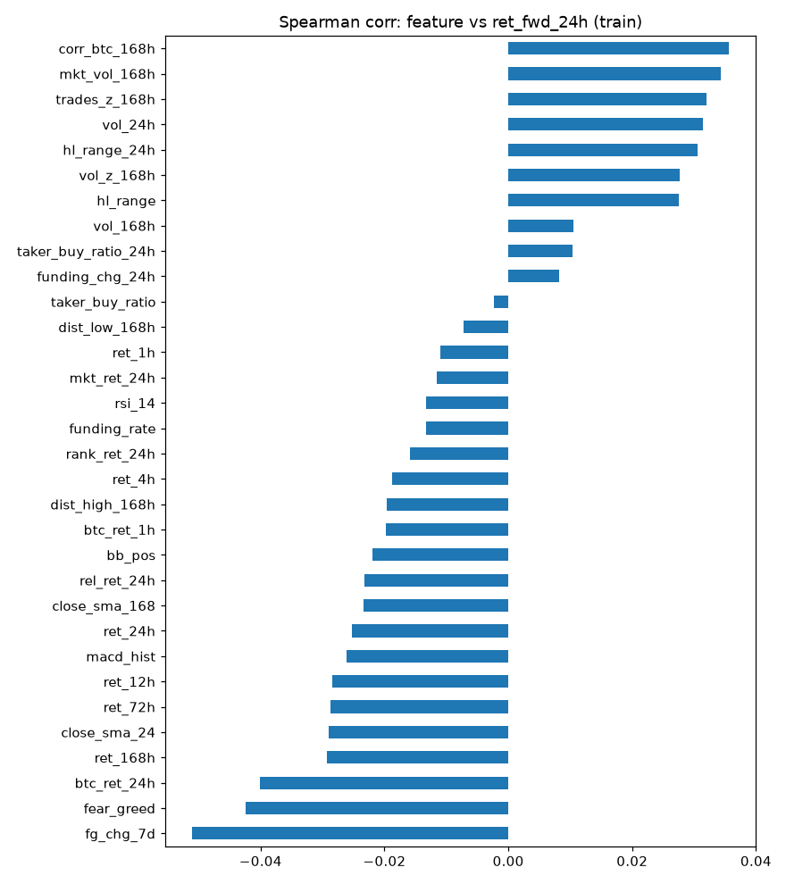
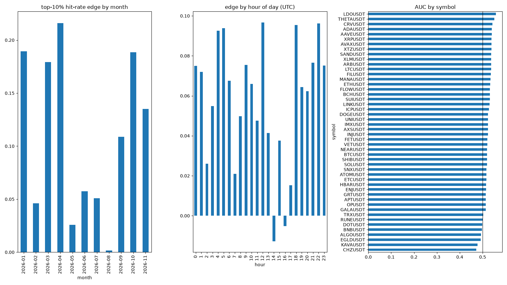
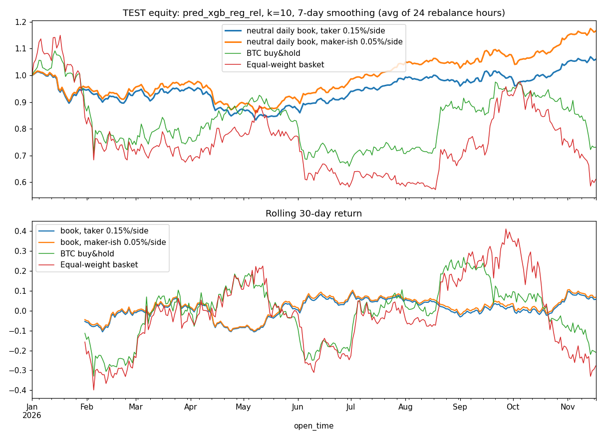
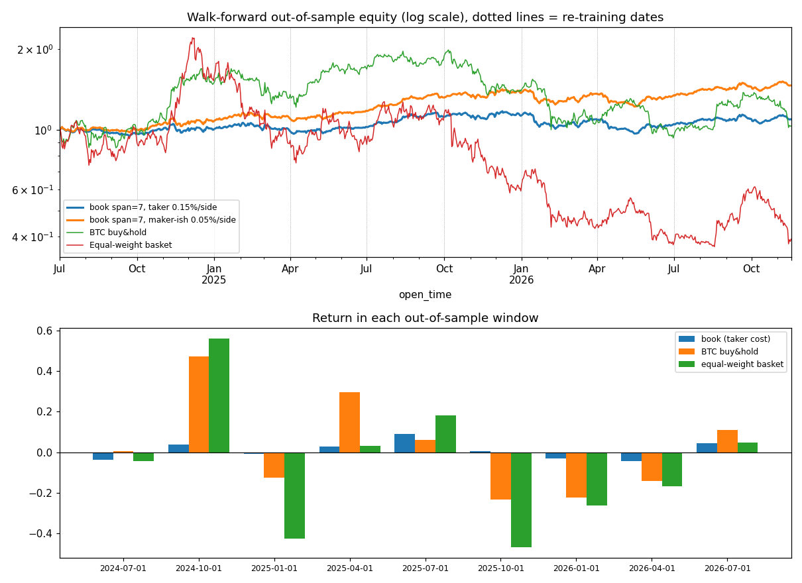

# Hourly Crypto Algo-Trading (top 50 USDT pairs)

End-to-end ML project for the MLZoomcamp course: download hourly crypto data, engineer
features, predict the next 24h return, simulate trading strategies against benchmarks,
and automate the whole workflow.

## 1. Problem description
**Goal:** every hour, rank 50 liquid Binance USDT pairs by the probability that they will
be higher 24 hours later, and turn those ranks into trades (long-only or long-short, at
most N concurrent positions, optional stop-loss). The output is a short list of trades
for the latest hour (`data/processed/latest_signals.csv`), optionally pushed to Telegram.

**Why it is a new setup:** hourly horizon on crypto (24/7 market, funding rates, high
volatility), 50 assets, >1.3M rows, instead of weekly trading of large-cap stocks.

**Honest headline result:** the models find a small, real ranking signal (test AUC about 0.51 to
0.52; the top-10% most confident calls hit 5 to 8 points more often than a blind long) but
the edge is **too small to survive 0.30% round-trip costs** and it did not generalise to the
2026 bear market. The hourly-entry strategies (sections 5 and 6b) lost money on TEST. The one approach that held up is a
**low-turnover, market-neutral daily-rebalance book** on a market-relative target (sections 6c and 6d). Walk-forward
validation over 9 out-of-sample quarters (2024-07 to 2026-11) shows a consistent ranking signal (rank-IC > 0 in all 9 folds)
but a modest, cost-sensitive profit: about **+3% CAGR with taker fees and +17% with maker-like costs** (Sharpe 0.26 and
0.96), with drawdowns of -16% to -20%. That is suggestive, not conclusive. The live book the pipeline prints is produced by
this strategy, but it is a demo of the automation, not investment advice.

## 2. Data sources
All data is free, needs no API key and is **not stored in GitHub**.

| Source | Content | Frequency |
|---|---|---|
| [data.binance.vision](https://data.binance.vision) spot klines (new source) | OHLCV, trade count, taker-buy volume, 50 USDT pairs | 1h |
| data.binance.vision USD-M futures funding | perpetual funding rate | 8h |
| [alternative.me](https://alternative.me/crypto/fear-and-greed-index/) | Fear & Greed index | daily |

`api.binance.com` is geo-blocked in some regions, so everything uses the public bulk archive,
which also supports incremental daily updates. Dataset: **1,305,006 rows**, 50 symbols,
2023-11 to 2026-11 (EOS and MKR stop in 2025 when Binance delisted them; they are kept in the
history so results are not survivor-biased).

Dataset copy (processed parquet + trained models) on Hugging Face: `https://huggingface.co/datasets/<your-hf-username>/crypto-hourly-top50`.
Restore it with `python -m src.hf_sync pull <your-hf-username>/crypto-hourly-top50`, or rebuild from scratch with the download step.

### Features (32 numeric + 21 dummy columns)
| Group | Features |
|---|---|
| Momentum | `ret_1h, 4h, 12h, 24h, 72h, 168h` |
| Volatility / range | `vol_24h, vol_168h, hl_range, hl_range_24h` |
| Volume / order flow | `vol_z_168h, trades_z_168h, taker_buy_ratio, taker_buy_ratio_24h` |
| Technical | `rsi_14, macd_hist, bb_pos, dist_high_168h, dist_low_168h, close_sma_24, close_sma_168` |
| Derivatives / sentiment | `funding_rate, funding_chg_24h, fear_greed, fg_chg_7d` (Fear & Greed uses the previous day, no look-ahead) |
| Market context | `btc_ret_1h, btc_ret_24h, corr_btc_168h, mkt_ret_24h, rel_ret_24h, rank_ret_24h, mkt_vol_168h` |
| Dummies / bins | `session` (asia/europe/us), `dow`, `vol_bucket` (terciles from TRAIN), `fg_regime` (5 bins), `liq_bucket` |

## 3. Data transformations and EDA
`src/transform.py` merges klines + funding (as-of join) + Fear & Greed into one table and defines
`TO_PREDICT = [ret_fwd_24h, y_up, y_up_1pct]`, `NUMERIC`, `DUMMIES`, `FEATURES`.
Chronological split with a 24h purge gap: **train** to 2025-06, **valid** 2025-07..12, **test** 2026.
The latest 24h have no target and are the `live` rows used for prediction.

`src/eda.py` (figures in `reports/`) findings on TRAIN:
- 24h return: mean +0.12%, std 5.2%, fat tails; P(up)=49.3%, P(>1%)=38.6%.
- All Spearman correlations are tiny (|rho| < 0.06). Signs hint at **mean reversion**: Fear&Greed,
  7d change, BTC 24h return and the momentum features correlate negatively with the next return.
- Mean forward return is +1.1% after "extreme fear" days and -0.5% on "neutral" days.



## 4. Modeling
`src/train.py` trains and tunes (random search on TRAIN, scored by AUC on VALID) a logistic regression,
a **DecisionTree**, a **RandomForest**, an **XGBoost** classifier and an XGBoost regressor on the return.

| Model | VALID AUC | TEST AUC |
|---|---|---|
| Logistic regression | 0.483 | 0.515 |
| Decision tree | 0.511 | 0.509 |
| Random forest | 0.520 | 0.513 |
| **XGBoost** | 0.520 | **0.523** |
| XGBoost regression (rank-IC on test) | | 0.039 |

Custom decision rule: trade only when the prediction is in the top 5/10/20% of confidence
(thresholds fixed on VALID).

## 5. Trading simulation (`src/simulate.py`)
Costs: 0.10% fee + 0.05% slippage per side.
- **Vector sims** (fields `sim1_..sim4_<model>`): long above threshold; top-k per hour; long-short;
  top-k only in fear regimes. Capital approximated with 24 tranches.
- **Exact sim** (iterates hour by hour): single capital pool, gains reinvested, max 1/3/5 concurrent
  positions, stop-loss, take-profit, sizing proportional to signal strength, long-short.
- Benchmarks: BTC buy-and-hold and an equal-weight basket. Metrics: CAGR, Sharpe, max drawdown,
  rolling 30-day return (`reports/equity_test.png`).
- Grid of 360 configurations chosen on VALID, reported on TEST.

TEST period (2026-01..11), exact sim, config picked on VALID:

| | Total return | CAGR | Sharpe | Max DD |
|---|---|---|---|---|
| Selected strategy (decision tree, long-short, 3 slots) | -40.9% | -45.0% | -1.23 | -47% |
| BTC buy&hold | -26.0% | -29.0% | -0.59 | -40% |
| Equal-weight basket | -35.5% | -39.3% | -0.54 | -51% |

Vector sim on TEST (top-10% signals): only the **XGBoost long-short (`sim3_xgb`)** was marginally
positive (CAGR +2.3%, Sharpe 0.24) in a market where the basket lost 35%. Details in `reports/sim_vector_test.csv`
and the full grid in `reports/sim_grid.csv`.

## 6. Findings, error analysis and ideas (`src/evaluate.py`)
- **Model selection on VALID did not transfer:** correlation between VALID Sharpe and TEST Sharpe across the
  360 configs is 0.07. The winner (a decision tree) was noise-fitting a 6-month window. A decision tree also outputs
  many identical probabilities, so "top-k" ties are broken arbitrarily (the latest signals are all 0.879 and
  alphabetical). Treat the current `latest_signals.csv` as a pipeline demo, not advice.
- **There is a signal, but it is small:** for XGBoost the top-10% calls hit about 5 to 8 points above base rate, yet
  their average 24h return is only about +0.1% to +0.4%, below the 0.30% cost of a round trip.
- **By ticker:** AUC ranges 0.47 (CHZ, KAVA) to 0.56 (LDO); BCH, XTZ, SAND, VET show the biggest edge,
  TRX and BNB none. **By month:** strong in Jan, Mar, Apr, Oct 2026, near zero in Aug. **By regime:** the edge is
  largest on days when BTC fell in the last 24h (+8.4 points vs +1.9) and in extreme-fear and greed regimes.
- **Regime shift:** training covers 2023-25 (mostly a bull market); 2026 is a bear market, so long-biased
  strategies lose. Debug file: `reports/worst_calls.csv`.
- **Ideas:** (1) cross-sectional target (return minus market mean) with a market-neutral long-short book;
  (2) walk-forward retraining; (3) longer holding periods or fewer trades to cut cost drag;
  (4) fewer grid configs and selection on a robust metric; (5) open-interest and order-book features;
  (6) probability calibration and de-duplicated tie-breaking.



## 6b. Second experiment: market-relative target and market-neutral book
Hypothesis: the first strategy lost because it was long-biased in a bear market. So the target became
"beats the average coin over the next 24h" (`y_up_rel`, `ret_fwd_rel_24h`), and the exact simulation got a
market-neutral mode (`neutral=True`: equal numbers of longs and shorts). Run it with
`python -m src.train --target rel` and `python -c "from src import simulate; simulate.run_rel()"`.

| Model (relative target) | VALID AUC | TEST AUC |
|---|---|---|
| Logistic regression | 0.544 | 0.536 |
| Random forest | 0.545 | 0.538 |
| XGBoost | 0.548 | 0.541 |
| XGBoost regression (rank-IC on test) | | 0.032 |

- **Ranking quality is better** (test AUC 0.54 vs 0.52), so cross-sectional prediction is easier than direction.
- **It still does not trade profitably.** All 24 neutral-book configurations had a negative TEST Sharpe
  (median CAGR -58% to -70%); the VALID-selected one returned -33.3% (Sharpe -1.13) vs -26.0% for BTC and -35.5% for the basket.
  Being market-neutral did not remove the loss, so the loss is cost-driven, not just regime-driven.
- **Why (decile check on TEST, gross of costs):** mean relative 24h return by prediction decile is not monotonic for the
  classifiers; top-minus-bottom spread is about -0.02% (XGB classifier), +0.08% (logistic) and +0.19% (XGB regression).
  The AUC gain comes from the middle of the ranking, not the tails that are actually traded. Even the best spread (0.19%)
  is below the 0.30% round-trip cost, so any hourly-entry, 24h-hold book loses money after costs.
- **Takeaway:** with taker-level costs, 24h predictions on this feature set do not carry enough gross edge. Promising next
  steps are lower turnover (hold longer, rebalance daily), maker fees, extreme-tail-only trading, and richer features
  (open interest, order book, on-chain), not more model tuning.

## 6c. Third experiment: daily-rebalance market-neutral book (lower turnover)
`simulate.daily_rebalance` / `simulate.run_daily()`: once a day, long the k coins with the best relative
prediction and short the k worst (50% of capital per side). Only the **change** in weights is charged, so coins that stay in
the book cost nothing; an EWMA over `span_days` smooths the signal to cut turnover. Results are averaged over all 24 possible
rebalance hours (no hour cherry-picking). Shorts are assumed on perpetual futures; funding payments are ignored.
Grid: 4 models x k in {5,10} x span in {1,3,7} days x 2 cost levels (taker 0.15%/side, maker-ish 0.05%/side),
selected on VALID and reported on TEST.

| Config picked on VALID (XGBoost regression, relative return, k=10, 7-day smoothing) | CAGR | Sharpe | Max DD |
|---|---|---|---|
| maker-ish cost 0.05%/side | +18.3% | 0.97 | -16.1% |
| taker cost 0.15%/side | +6.2% | 0.41 | -18.5% |
| BTC buy&hold (same period) | -29.0% | -0.59 | -40.3% |
| Equal-weight basket | -39.3% | -0.54 | -51.5% |

- **Smoothing and low turnover are what made the difference:** average TEST Sharpe by smoothing span is -1.06 (1 day),
  -0.12 (3 days) and +0.38 (7 days); average daily turnover fell from about 100% to 30% of capital.
- **Selection is now meaningful:** VALID/TEST Sharpe correlation across the grid is 0.54 (0.07 in the first experiment).
  The top VALID configs that failed on TEST were all 1-day (high-turnover) settings.
- **Caveats (please read):** the TEST window is only about 320 days and one (bear) regime; a Sharpe of about 1 over less than a year is
  **not statistically significant** (standard error about 1). Only 40% of all grid configs are profitable on TEST. The
  maker-ish scenario assumes limit orders fill; benchmarks are long-only, so beating them in a bear market is partly the
  benefit of being market-neutral. Treat this as a promising direction needing walk-forward validation, not a proven edge.



Reproduce: `python -c "from src import simulate; simulate.run_daily()"` (about 1 min), output `reports/sim_daily_rebalance.csv`.

## 6d. Walk-forward validation of the daily book (`src/walkforward.py`)
To avoid relying on one test window, the XGBoost regressor (relative return, fixed hyperparameters) is **re-trained on an
expanding window before each of 9 quarterly folds** (2024-07 to 2026-11, 24h purge gap) and predicts only the next unseen quarter.
The chained predictions give 2.4 years of out-of-sample history. k=10; results averaged over the 24 rebalance hours.



| Pooled out-of-sample, k=10 | CAGR | Sharpe | Max DD | Folds with profit |
|---|---|---|---|---|
| 7-day smoothing, maker-ish cost (0.05%/side) | +16.7% | 0.96 | -15.7% | 6 of 9 |
| 7-day smoothing, taker cost (0.15%/side) | +3.3% | 0.26 | -19.8% | 5 of 9 |
| 3-day smoothing, maker-ish | +14.1% | 0.82 | -18.3% | 7 of 9 |
| no smoothing, taker | -27.3% | -1.72 | -56.6% | 0 of 9 |

- **The signal is stable:** rank-IC between predicted and realised relative return is positive in all 9 folds (0.016 to 0.053, mean about 0.036).
- **Profit is cost-sensitive:** with taker fees the book is roughly break-even (+3% CAGR); with cheaper execution it earns about +15% to +17%.
  Without smoothing (daily turnover about 100%) it loses money at taker costs in every fold.
- **Behaves like a market-neutral book:** it lags in strong bull quarters (2024-Q4: +3.7% vs BTC +47%) and holds up in bear
  quarters (2025-Q4: +0.7% vs BTC -23%). Over the full period BTC is about flat while the equal-weight basket lost about 60%.
- **Honest limits:** a Sharpe of 0.96 over 2.4 years has a standard error of about 0.65, so it is about 1.5 sigma: promising, not proven.
  k and the smoothing span were first picked on 2025-H2, so folds from 2025-07 are not fully independent of that choice (the span 1/3/7
  sensitivity above shows the conclusion does not hinge on one value). Funding payments on perpetual shorts, borrow limits and
  market impact are ignored. The weaker folds (2024-Q3, 2026-Q1, 2026-Q2) lost 3% to 5%.

Reproduce: `python -m src.walkforward` (several minutes). Output: `reports/walkforward_folds.csv`, `reports/walkforward_pooled.csv`.

## 7. Automation
```
download -> transform -> (eda) -> (train) -> (simulate) -> predict -> Telegram
```
- `run_pipeline.py` is the entry point. **Two regimes:** `--mode download` (fetch newest data) or
  `--mode file` (reuse the files on disk or a copy restored with `src/hf_sync.py pull`, no download).
- **Incremental loading:** `src/download.py` appends only missing months/days to parquet files on disk (not GitHub).
- **Cron:** `cron/crontab.txt` (daily at 02:30 UTC). The archive publishes a day's file after the day ends, so
  predictions are for the last available hour (up to about a day old). That is a real limitation for a 24h horizon.
- `notebooks/workflow.ipynb` calls every module end to end.
- **Daily output:** `predict.py` builds today's target book (k longs, k shorts, with OPEN/CLOSE/hold actions vs yesterday)
  into `data/processed/latest_book.csv`, using the config in `reports/best_strategy_daily.json`. Re-train periodically with
  `python -m src.train --target rel`.
- **Optional alerts:** set `TELEGRAM_BOT_TOKEN` and `TELEGRAM_CHAT_ID`; otherwise it is a no-op.

## 8. Setup and run
```bash
python -m venv .venv
.venv\Scripts\activate          # Windows (Linux/macOS: source .venv/bin/activate)
pip install -r requirements.txt

python run_pipeline.py --steps download transform eda train simulate predict   # full research run (about 20 min)
python run_pipeline.py                                                         # daily update
python -m src.evaluate                                                         # error analysis
```
Docker: `docker build -t crypto-algo .` then `docker run -v "$(pwd)/data:/app/data" -v "$(pwd)/models:/app/models" crypto-algo`
(runs the daily update; restore data/models first with `python -m src.hf_sync pull ...`).

## 9. Layout
```
src/config.py     pairs, paths, dates          src/train.py      models + tuning
src/download.py   incremental downloader       src/simulate.py   vector + exact sims, metrics
src/transform.py  merge, features, targets     src/evaluate.py   error analysis
src/eda.py        EDA                          src/predict.py    today's target book (daily strategy)
src/walkforward.py  walk-forward validation
run_pipeline.py   workflow entry point         src/notify.py     Telegram (optional)
notebooks/workflow.ipynb   cron/crontab.txt    reports/          figures and result tables
```
